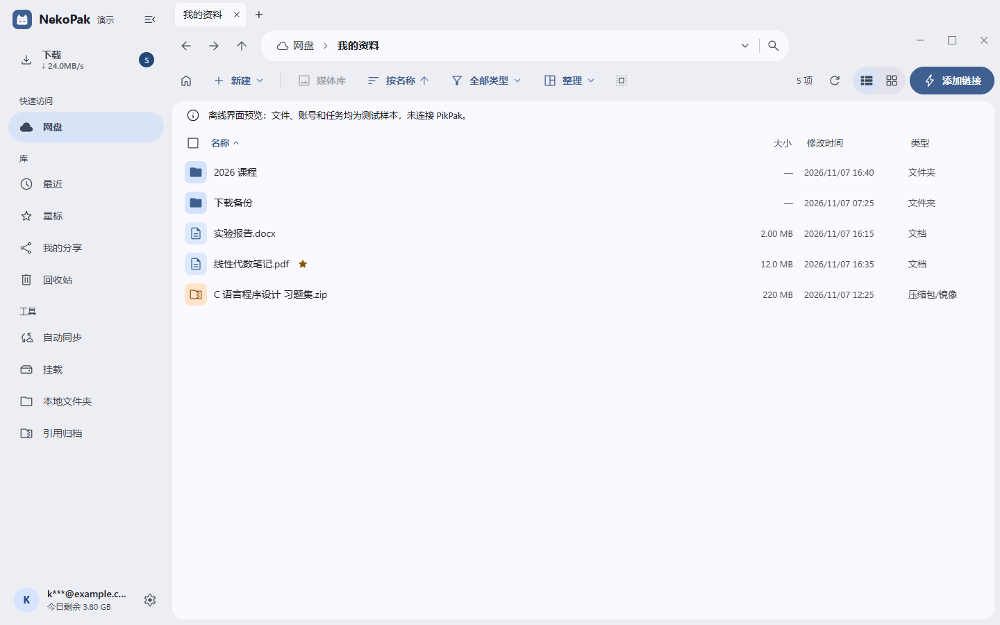
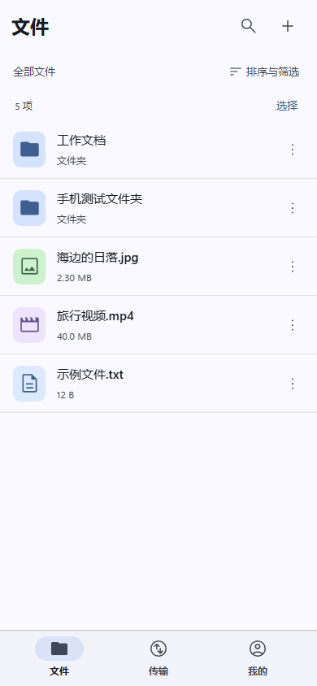
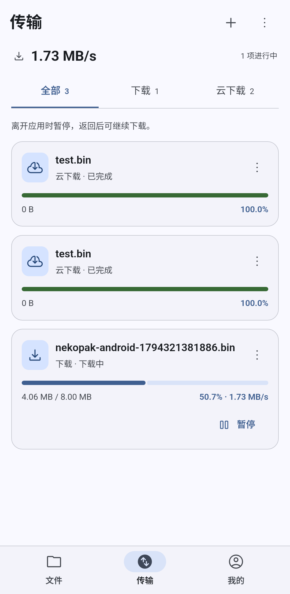
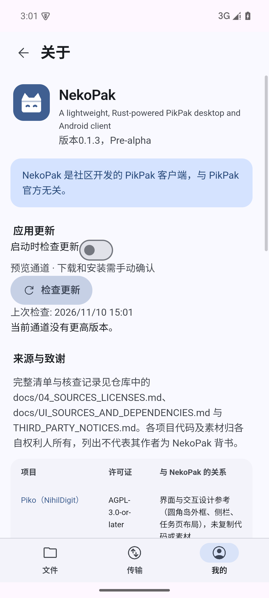

<p align="center">
  
</p>

# NekoPak

轻量的 PikPak 桌面与 Android 客户端。用 Rust 处理文件、传输和任务恢复，以 Tauri + Preact 提供桌面窗口和独立手机界面。

*A lightweight, Rust-powered PikPak client for Windows and Android.*

[下载 0.1.3 预览版](https://github.com/NekoPak/NikoPak/releases/tag/v0.1.3) · [使用指南](docs/USER_GUIDE.md) · [更多截图](docs/SCREENSHOTS.md) · [更新记录](CHANGELOG.md) · [问题反馈](https://github.com/NekoPak/NikoPak/issues)

> **当前为 Pre-alpha 预览。** Windows x64 与 Android ARM64 已有可安装包；真实账号、物理手机和完整上游功能仍逐项验收。NekoPak 是独立社区项目，与 PikPak 官方无隶属关系。

## 下载与安装

- **Windows 安装版**：[Setup.exe · 4.07 MiB](https://github.com/NekoPak/NikoPak/releases/download/v0.1.3/NekoPak-0.1.3-windows-x64-setup.exe)。当前用户安装，带快捷方式和卸载入口。
- **Windows 便携版**：[ZIP · 7.00 MiB](https://github.com/NekoPak/NikoPak/releases/download/v0.1.3/NekoPak-0.1.3-windows-x64-portable.zip)。完整解压，运行 `NekoPak/nekopak.exe`，保留同目录许可文件。
- **Android ARM64**：[APK · 16.84 MiB](https://github.com/NekoPak/NikoPak/releases/download/v0.1.3/NekoPak-0.1.3-android-arm64-v8a.apk)。Android 7.0 / API 24 起，使用系统 Android WebView。

Windows 需要 x64 系统和 Microsoft Edge WebView2；安装版可在缺少 WebView2 时下载微软引导器。Linux / macOS 目前完成核心 CI，尚无经过桌面验收的发行包。上述大小来自 [0.1.3 的实际构建](docs/UPDATES_PROGRESS_REPORT.md)，不含系统运行时。

**从 0.1.2 或更早版本升级，需要手动安装 0.1.3 一次。** 后续在 Windows **设置 → 关于**、Android **我的 → 关于 → 应用更新**检查新版本。Android 直接覆盖安装原签名版本即可；卸载会删除应用私有下载和登录数据。

## 界面预览

桌面文件浏览支持路径导航、排序、搜索、多标签、右键操作及明暗主题。下图使用应用内置的离线演示数据，保留了演示提示。

<picture>
  <source media="(prefers-color-scheme: dark)" srcset="docs/screenshots/readme/desktop-files-dark.png">
  
</picture>

手机使用 **文件／传输／我的** 底部导航。单击打开文件夹，长按多选；下载卡片同时显示字节、百分比和速度。

<p>
  
  
  
</p>

从左到右：手机布局样例、Android 原生下载测试、已签名发行版检查更新。后两张来自隔离模拟器；截图不包含真实账号，也不代表真实服务网速。[查看截图说明与更多页面 →](docs/SCREENSHOTS.md)

## 当前功能

以下功能已接入代码并完成相应的离线或原生测试；服务端结果、账号权限与格式兼容性以实际使用为准。

- **账号与文件**：应用内邮箱密码登录、记住账号、会话恢复、多账号切换；文件夹浏览、分页搜索、最近、星标、回收站和基础文件操作。
- **本地下载**：原文件下载、暂停／继续、重启后校验续传、限速、同名目标保护；进度按实际接收字节刷新，断点按已校验落盘字节恢复。
- **云下载**：链接／磁力任务，以及 `.torrent` 文件选择、预览和确认提交。种子支持 v1 与含 v1 信息的混合格式，最大 10 MiB；纯 v2 暂不支持。
- **媒体与片段**：视频预览、起止时间选择、关键帧对齐和原文件／可用画质选择；原生媒体核心处理支持范围内的 MP4、MKV、TS。具体编码、容器和平台限制见[媒体说明](crates/nekopak-media/README.md)。
- **桌面整理工具**：目录上传、批量重命名、重复文件检查、分享、归档、本地只读映射和同步已接入。Cloud Files 与可选 WinFsp 分别检测能力；驱动、真实服务及复杂操作的验收范围见[集成记录](docs/DESKTOP_INTEGRATION_REPORT.md)。
- **应用体验**：简体中文、繁体中文、英语、日语、韩语；明暗主题；Windows 托盘与自启动；Android 系统文件导出和软键盘避让。
- **应用更新**：公开预览通道、更新说明、下载／取消、确认安装，可选启动检查。清单签名、包长度与 SHA256 验证通过后才能安装。

### 手机当前限制

Android 本地下载保存在应用私有目录，完成后使用 **导出文件**保存到系统选择的位置。**0.1.3 切到后台或锁屏会暂停本地传输，返回后需手动继续**；云端任务继续由服务端处理。通过系统通知在后台继续传输的功能已进入主干，随下一个预览版发布，尚未在实体手机上验收。

Android 普通上传、共享目录同步、本地映射、外部播放器和前台持续下载服务尚未完成。Windows 托盘、Cloud Files 和 WinFsp 不适用于手机。完整平台说明见 [Android 文档](docs/ANDROID.md)。

## 从这里开始

1. 安装对应平台的包，在 NekoPak 中输入自己的账号。需要人工验证时，按应用提示完成后返回继续；无需配置开发者参数。
2. Windows 在 **设置 → 下载与传输**选择下载目录；Android 下载完成后从任务卡片或菜单导出文件。
3. 点击 **添加链接**，粘贴链接或切到 **种子文件**。检查目标目录与预览内容，确认后提交云下载。
4. 在传输页查看任务。云下载保存到云盘，本地下载保存到设备；提交成功与下载完成是不同状态。

详细操作、网络重连、版本升级和常见问题见[使用指南](docs/USER_GUIDE.md)。

## 0.1.3 带来了什么

- 接入可实际使用的公开更新源，支持 Windows 与 Android 的确认安装流程。
- 修复“有下载速度但进度条不动”：当前网络块尚未落盘时，界面也能显示已收到的真实字节。
- 包含 0.1.2 的吞吐、种子导入和手机键盘修复。相同本地 16 MiB 测试由约 9.26 秒降至 1.08 秒，文件 SHA256 一致；这不是实际服务网速承诺。

[完整更新记录](CHANGELOG.md) · [更新与进度验收](docs/UPDATES_PROGRESS_REPORT.md) · [速度、种子及键盘修复](docs/SPEED_TORRENT_IME_REPORT.md)

## 数据与安全

密码仅用于当前请求。Windows 会话保存在系统凭据管理器，Android 使用 Keystore 密钥加密会话；不会把密码或令牌写入普通配置和任务日志。损坏任务库会报错并保留，不静默重置。

普通文件浏览与下载由 Rust 直接访问社区客户端协议，无 PikPak CLI 安装或回退路径。可配置应用内代理，网络增强默认关闭，不修改系统 Hosts。配额以账号与服务响应为准。

发行包包含许可证与依赖清单。更新使用 NekoPak 自己的 Ed25519 签名协议，Android 另有 APK 签名；**Windows 发布清单签名不等于 Authenticode 证书**。核验方法见[发布与签名](docs/RELEASE_SIGNING.md)。

## 开发与验证

Windows 开发需要 Rust 1.98+（MSVC）、Visual Studio C++ 工具、Windows SDK、Node.js 22+ 和 WebView2。Python 3.12+ 用于打包。

```powershell
npm ci
npm run build
cargo run -p nekopak-app --locked
```

`npm run dev` 打开的是离线浏览器演示，不能登录真实账号。原生运行、模拟后端和打包命令见 [RUNNING.md](docs/RUNNING.md)；Android 使用单独的 [SDK / NDK 构建流程](docs/ANDROID.md)。

```powershell
cargo fmt --all --check
cargo test --workspace --locked
cargo clippy --workspace --all-targets --locked -- -D warnings
npm test
npm run build
python scripts/check_parity.py
```

0.1.3 已记录 Rust 194 项通过、20 项显式跳过，前端及接口 124 项通过、桌面浏览器 57 项、手机布局 12 项、Android 原生 17 项；更新原生测试两端各 7 项。另完成最终包验签、Windows 安装／卸载、APK 覆盖升级与冷启动、公开更新源检查。[测试证据](docs/evidence/updates-checks.json) · [签名构建](https://github.com/NekoPak/NikoPak/actions/runs/42836719725)

最终目标保留上游已发布功能，包括视频指定片段下载。**当前 24 组必需能力尚未全部验收**，预览发布不等于功能对齐完成。Windows 稳定性、其他平台适配和安全同步持续按[路线图](docs/05_ROADMAP_AND_TESTS.md)及[功能清单](docs/UPSTREAM_PARITY.md)推进。Windows Lite 的 ≤5 MiB 压缩目标仍是挑战值，不能据此牺牲 TLS、完整性或持久化。

## 文档与反馈

- [使用指南](docs/USER_GUIDE.md)：安装、登录、下载、种子、更新与常见问题。
- [截图集](docs/SCREENSHOTS.md)：桌面明暗主题、任务、视频选段和 Android 页面。
- [文档索引](docs/README.md)：构建、架构、契约、平台、研究与验收记录。
- [提交问题](https://github.com/NekoPak/NikoPak/issues)：附版本、平台、复现步骤、预期和实际结果；截图与日志先隐藏个人信息，勿提交密码、令牌或带授权参数的链接。

## 许可与致谢

NekoPak 主仓采用 [MIT License](LICENSE)。这是独立 Rust 项目，未复制 AGPL Piko 的实现代码。

感谢 [Piko](https://github.com/NihilDigit/piko)、[pikpaktui](https://github.com/Bengerthelorf/pikpaktui)、[pikpakcli](https://github.com/52funny/pikpakcli)、[pikpak-kotlin](https://github.com/NihilDigit/pikpak-kotlin)、[PikPak Enhancement Master](https://github.com/digbug82/PikPak_Enhancement_Master)、[MediaMP](https://github.com/open-ani/mediamp) 和 [Rclone](https://github.com/rclone/rclone) 提供的功能、协议或设计参考，以及 Tauri、Preact、Rust 生态和可选 WinFsp 平台能力。

参考研究、直接依赖与外部组件的关系、版本及许可分别记录在 [THIRD_PARTY_NOTICES.md](THIRD_PARTY_NOTICES.md) 和[来源审计](docs/04_SOURCES_LICENSES.md)。Lite 不捆绑 JVM、Chromium、mpv/FFmpeg、Rclone、WinFsp 或 PikPak CLI。
