# 界面截图

对应 **0.1.3 预览版**，整理于 2026-11-10。[返回首页](../README.md) · [使用指南](USER_GUIDE.md)

截图来自运行中的应用界面，没有重绘控件或拼接虚构功能。桌面截图使用内置离线演示；手机图片分别注明浏览器样例、原生调试版或已签名发行版。样例文件、速度与账号不能作为真实 PikPak 服务验收证据。

## 原生桌面客户端

以下截图由原生客户端在离线演示数据下自行输出（`automation` 构建的脚本化截图，Linux、
1280×760）。Windows 上的字体和窗口边框会不同。

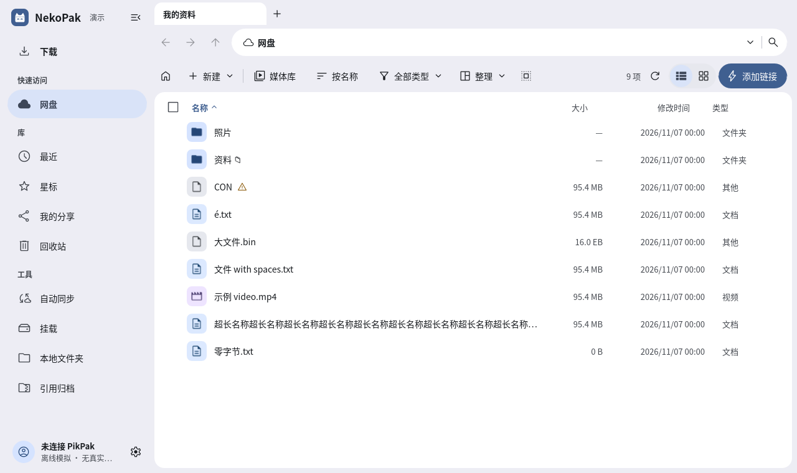

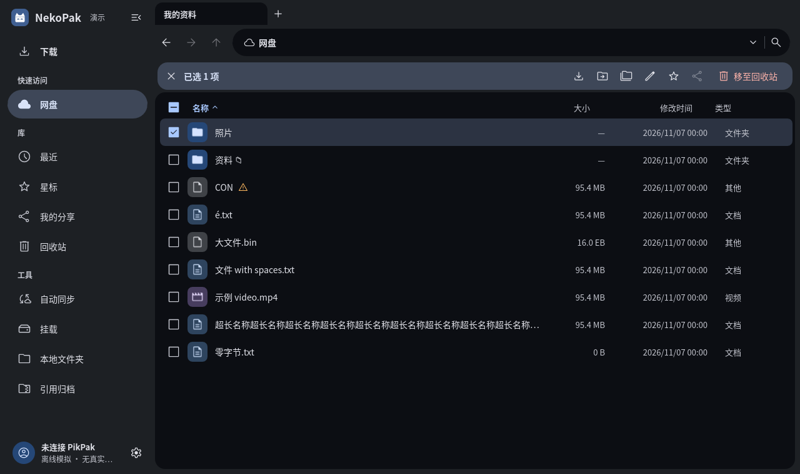

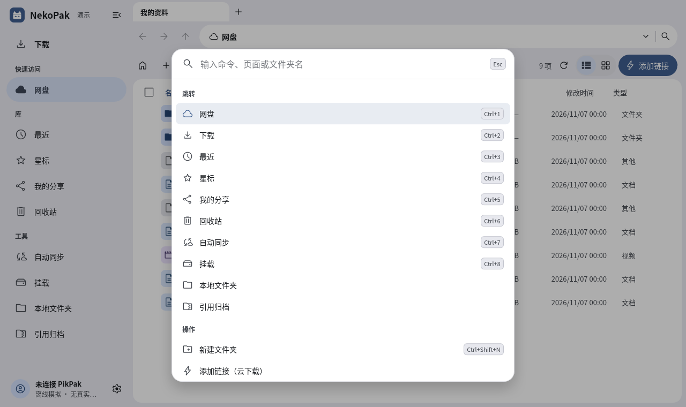

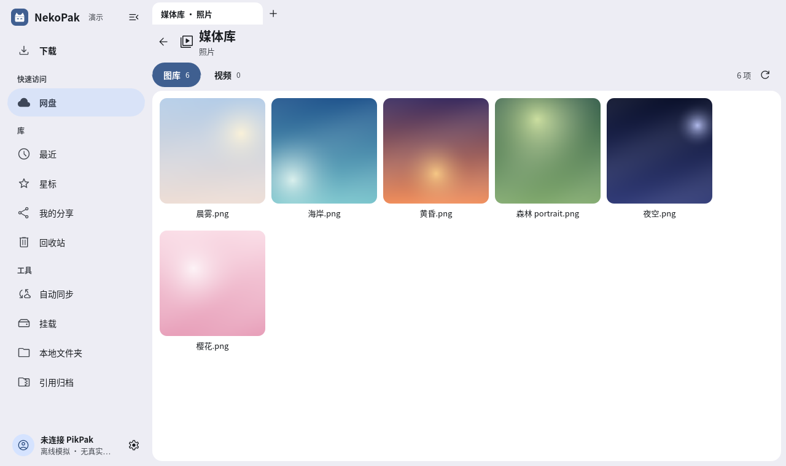

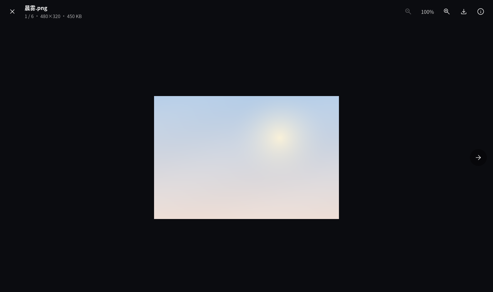

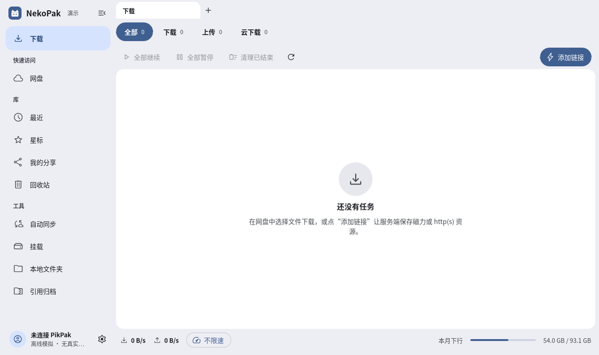

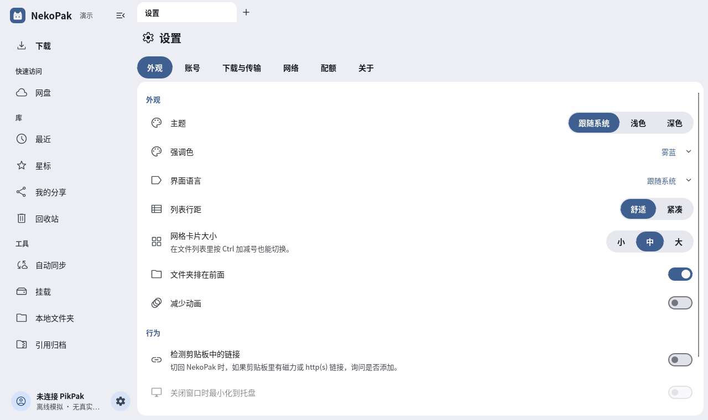

下面“桌面”一节的旧截图来自手机 / 网页界面开发时的 WebView 桌面布局，保留作对照。

## 桌面文件浏览

侧栏、路径导航、文件排序和操作工具栏。浅色与深色使用相同的演示文件夹。

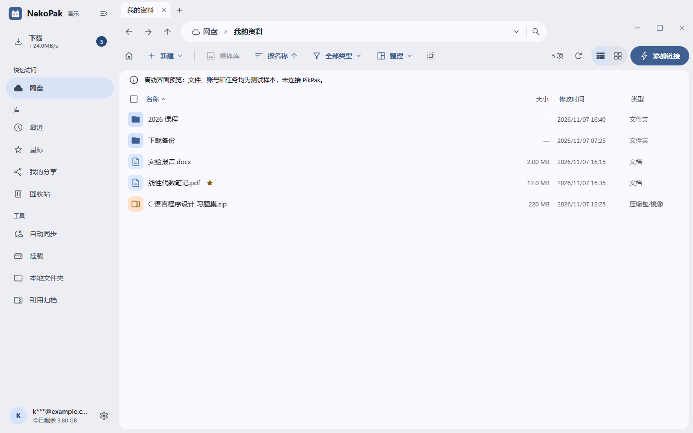

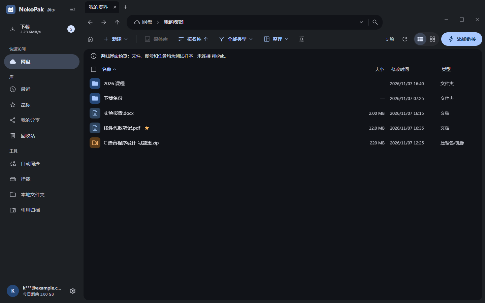

## 桌面任务与视频片段

传输页集中显示需要处理、进行中和已完成的任务。下面的错误和进度均是内置演示场景，便于展示不同状态。

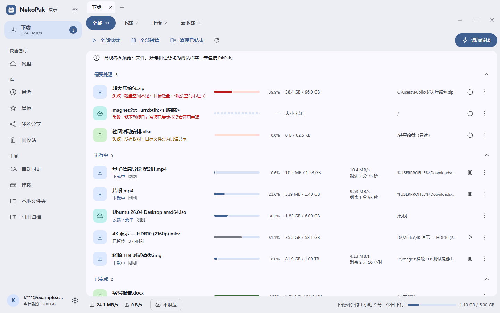

视频指定片段面板可设置起止点并显示关键帧提示。图中是内置示意预览，不是已解码的真实视频；原生支持范围见[媒体说明](../crates/nekopak-media/README.md)。

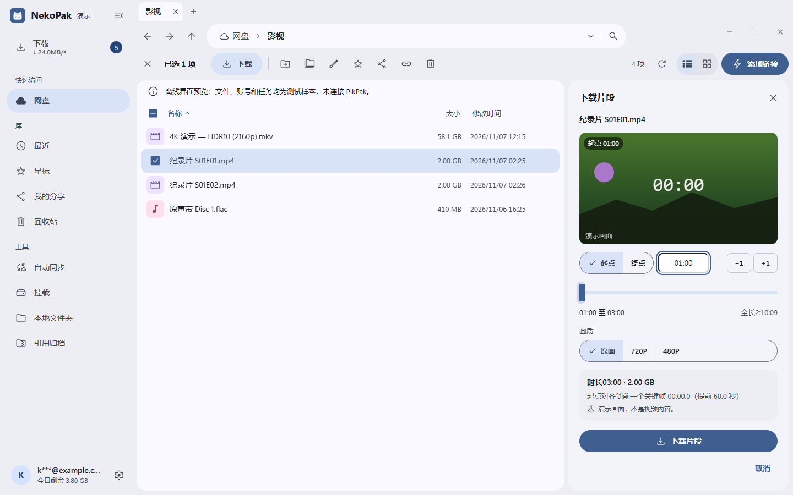

## 手机文件、传输与种子

左图为浏览器 IPC 样例的触屏文件页；中图为 Android 原生调试包读取本地 HTTP 测试服务时的真实进度；右图为浏览器种子导入样例。中图的实际网络与磁盘链路通过了自动化检查，但来源不是用户云盘。

<p>
  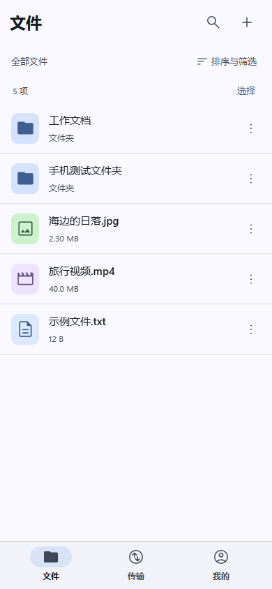
  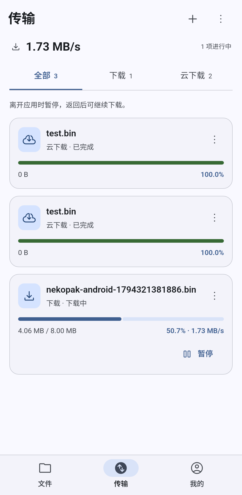
  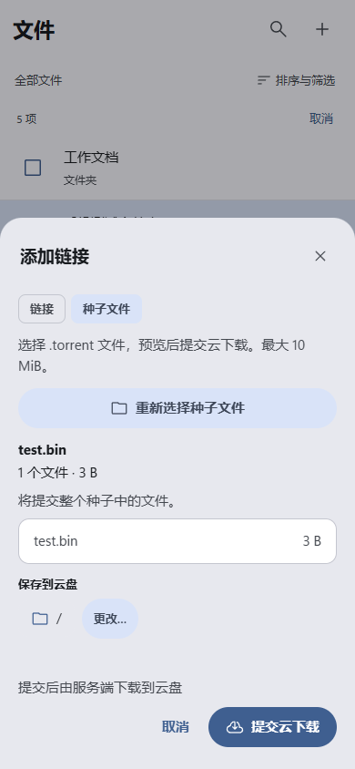
</p>

## Android 登录与更新

前两张来自已签名 **0.1.3 ARM64 发行包**，在 Android 15 / API 35 隔离模拟器上通过 ARM 翻译桥运行：登录入口，以及无需账号的公开更新检查。第三张是原生调试版与同签名测试候选之间的系统更新确认；候选仅用于测试，没有公开发布。

<p>
  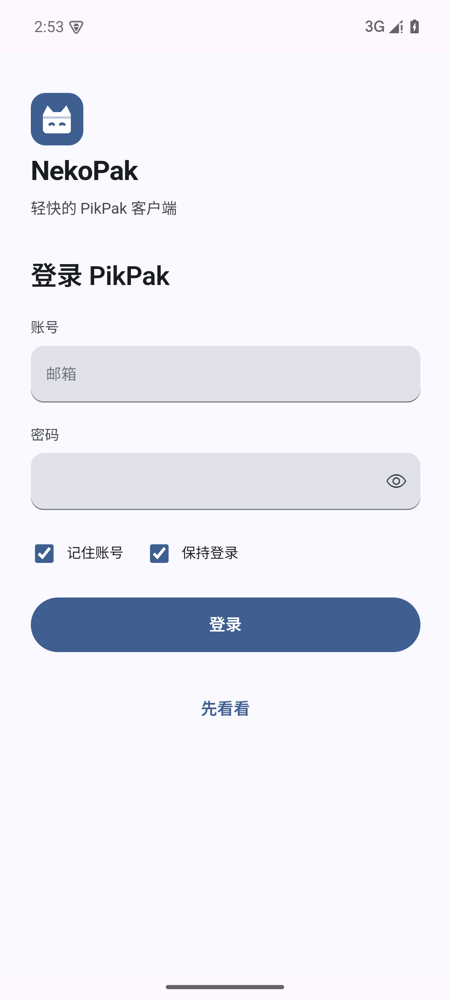
  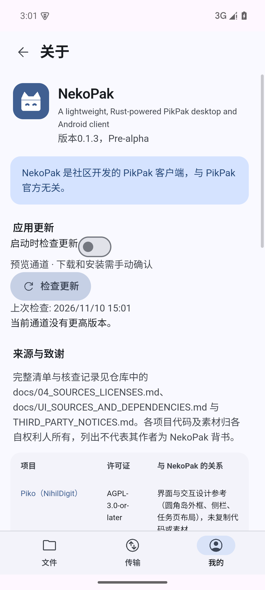
  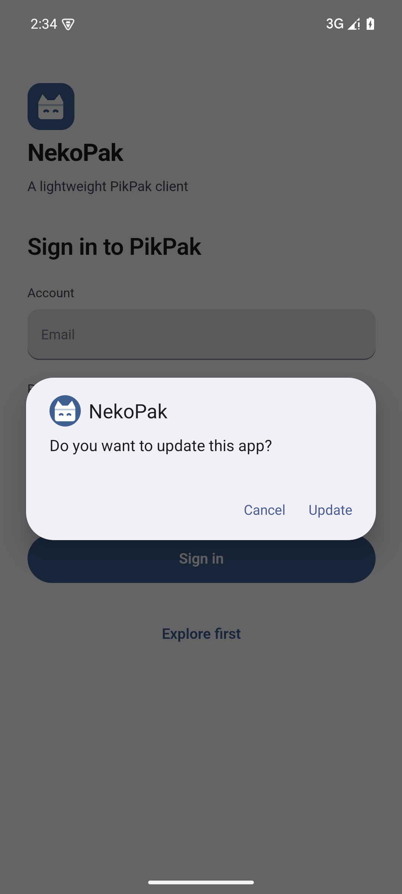
</p>

这些是模拟器实拍，不替代物理手机、第三方输入法、真实账号或任意系统安装器的验收。

## 复现与来源

四张桌面文档截图可从仓库根目录重新生成：

```powershell
npm ci
npm run build
node scripts/capture-doc-screenshots.mjs
```

Windows 默认使用已安装的 Microsoft Edge；其他平台可使用 Playwright Chromium。脚本只允许访问本机预览，检查页面错误与横向溢出，将 PNG 和版本、源码提交、尺寸、SHA256 记录到 [capture.json](screenshots/readme/capture.json)。

手机截图复用已经验收的原始 PNG，没有二次处理：

- 文件与种子样例：[mobile.mjs](../tests/e2e/mobile.mjs)、[手机布局记录](evidence/updates-mobile-ui.json)。
- 原生进度：[android-native.mjs](../tests/e2e/android-native.mjs)、[17 项原生检查](evidence/updates-progress-android-native.json)。
- 系统安装确认：[update-native.mjs](../tests/e2e/update-native.mjs)、[原生更新检查](evidence/updates-native-android.json)。
- 发行版登录与公开更新：[android-release.mjs](../tests/e2e/android-release.mjs)、[最终 APK 运行记录](evidence/0.1.3-android-release-runtime.json)。

完整版本验收与文件哈希见 [UPDATES_PROGRESS_REPORT.md](UPDATES_PROGRESS_REPORT.md)。
