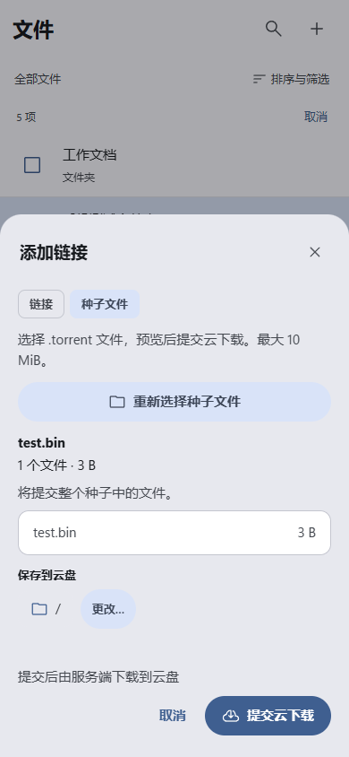
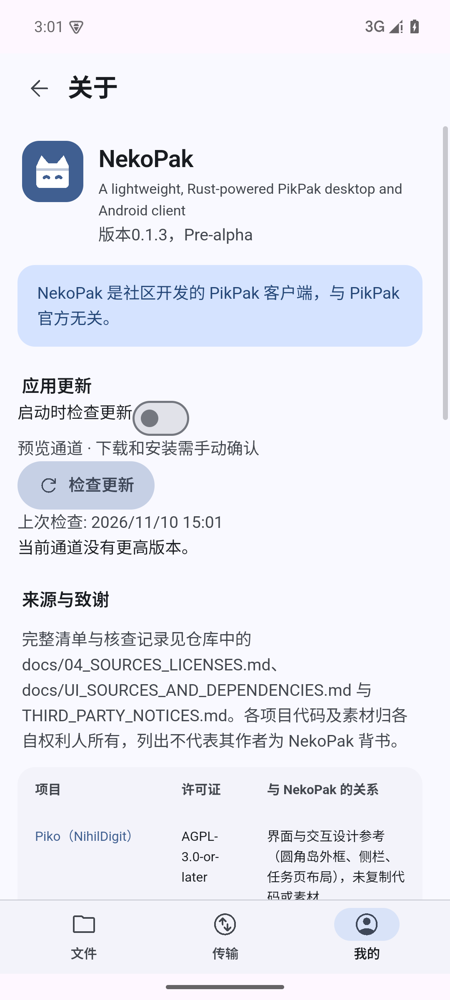

# NekoPak 使用指南

适用版本：**0.1.3 预览版**。需要编译源码时请看 [RUNNING.md](RUNNING.md)，日常使用直接安装[发行包](https://github.com/NekoPak/NikoPak/releases/tag/v0.1.3)即可。

[安装](#安装) · [登录](#登录与会话) · [下载](#下载到设备) · [云下载与种子](#云下载与种子文件) · [更新](#检查和安装更新) · [常见问题](#常见问题)

> 本指南的安装部分对应已发布的 0.1.3。下一版桌面端改为原生界面（不再需要 WebView2），新增内容见下方“下一版桌面端”。

## 下一版桌面端（尚未发布）

- **命令面板**：`Ctrl+K` 输入几个字即可跳转页面、文件夹或执行命令；`F1` 查看全部快捷键。
- **预览**：双击图片在应用内查看（滚轮或 `+` `-` 缩放，`←` `→` 切换）；“媒体库”按钮以缩略图墙浏览当前文件夹的图片或视频。
- **视频**：Windows 上双击视频可看画面预览、拖动定位、静音试播，按 `I` / `O` 标记起止点后“下载片段”。带声音的完整播放请点“用播放器打开”。系统缺少 Media Foundation 时没有画面预览，其余功能不受影响。
- **拖放**：把文件拖到文件夹、路径栏的上级目录或侧栏的固定文件夹上即可移动，按住 `Ctrl` 为复制；从资源管理器拖入文件或文件夹即上传到当前文件夹。
- **剪贴板链接提醒**：在“设置 → 外观 → 行为”中开启后，切回窗口时若剪贴板里有磁力或 http(s) 链接会询问是否添加。默认关闭。
- 系统要求：Windows 10 1709 或更新版本，x64。

## 安装

### Windows x64

安装版运行 `NekoPak-0.1.3-windows-x64-setup.exe`，按向导安装到当前用户目录。安装器会创建快捷方式和卸载入口；缺少 WebView2 时可下载微软引导器。

便携版完整解压 `NekoPak-0.1.3-windows-x64-portable.zip`，运行其中的 `NekoPak/nekopak.exe`。保留许可文件；“便携”指程序目录免安装，账号和任务数据仍保存在用户的应用数据目录。

这两个包均有 Ed25519 发布清单，但 EXE 尚无 Windows Authenticode 签名。仅从项目 Release 取得包；需要验证来源时查看[签名说明](RELEASE_SIGNING.md)，无需关闭系统防护。

### Android ARM64

下载 `NekoPak-0.1.3-android-arm64-v8a.apk`，通过系统安装界面安装。最低 Android 7.0 / API 24，要求 ARM64 设备和系统 WebView。系统若询问是否允许当前下载来源安装应用，按系统提示处理。

从同签名旧版本升级时直接覆盖安装，保留应用数据。**不要为了升级先卸载**：卸载会删除应用私有下载和登录数据。测试用 debug APK 与公开版签名不同，不能互相覆盖。

## 登录与会话

打开应用，在登录页填写邮箱和密码。“记住账号”保存账号名偏好，“保持登录”允许下次恢复会话；密码始终只用于当前请求。Windows 使用系统凭据库，Android 使用系统 Keystore 加密保存会话。

服务要求人工验证时，点击应用中的验证入口，完成浏览器步骤后返回继续。登录阶段可能要求重新输入密码，因为先前密码已清除；已登录后的网盘验证使用当前会话。不要在聊天、Issue 或日志附件里发送密码、验证码或令牌。

可以先点 **先看看**进入界面，再到账号页登录。安装的原生应用不会因此生成假的云盘数据；浏览器开发预览才使用演示数据。

## 浏览与整理文件

Windows 双击进入文件夹，通过路径栏返回上级；右键文件打开操作菜单。工具栏提供排序、搜索、列表／网格、批量操作等入口，多标签保留各自的浏览位置。

Android 单击打开文件夹，长按进入多选，也可点 **选择**；每行右侧的更多菜单提供相应操作。底部 **文件／传输／我的**用于切换页面，输入密码时底栏会暂时隐藏，关闭键盘后恢复。

删除操作区分移到回收站和永久删除。能力不可用时入口会禁用并说明原因；同步、挂载、分享和媒体的支持范围以对应页面及[集成记录](DESKTOP_INTEGRATION_REPORT.md)为准。

## 下载到设备

### Windows

1. 打开 **设置 → 下载与传输**，选择已有的本地下载目录。
2. 选择文件，使用 **下载**或文件菜单。开启 **下载时询问保存位置**后，每次由系统选择器确认目录。
3. 在左侧 **下载**页查看进度、暂停或继续。任务菜单可打开该任务对应的文件夹。

下载不会覆盖已有同名目标。暂停／重启后继续时，会先核对已下载字节和来源，再从可靠位置恢复；损坏数据库或来源变化会报错，不静默清空记录。

### Android

选择文件开始下载，在底部 **传输**页查看任务。完成后使用卡片或菜单中的 **导出文件**，通过系统保存选择器放到 Downloads 等共享位置。取消导出保留应用内的原文件。

**下载完成不等于文件已经导出。** 未导出的文件位于应用私有目录，其他应用未必能看到，卸载会删除它们。

Android 当前切到后台、锁屏或打开其他系统页面时会暂停本地任务。返回后点击 **继续**；尚未提供前台持续下载服务。云下载任务运行在服务端，不受这一暂停规则影响。

## 云下载与种子文件

云下载由服务端保存到云盘；要放到本机，还需对云盘里的文件执行本地下载。

Windows 点击 **添加链接**；手机在文件页右上角 **＋ → 添加链接**，或传输页直接点 **＋**。

### 链接或磁力

在 **链接**页签粘贴资源，查看校验和可用的预览结果，确认保存目录后点 **提交云下载**。任务出现表示提交已接受，是否完成要看后续任务状态。

### 本地 `.torrent` 文件

1. 切到 **种子文件**，点 **选择种子文件**。
2. 从系统文件选择器选择 `.torrent`。检查名称、文件数、大小与保存目录。
3. 点击 **提交云下载**。取消选择或关闭预览不会创建任务。

当前支持 v1 和含 v1 信息的混合种子，最大 10 MiB，纯 v2 暂不支持。最多展示前 200 个文件，提交包含整个种子。私有种子仍取决于服务端的站点访问权限。

应用会读取种子元数据、计算资源标识，再按云下载协议提交；它不是将 `.torrent` 当作普通文件上传到云盘。仅凭提交成功不能确认资源可下载。

*种子导入界面示例，使用浏览器测试数据。*

## 视频指定片段

在支持的文件菜单中选择 **下载指定段落…**，设置起点和终点，查看可用画质与实际关键帧对齐位置，再确认下载。切换画质、系统解码能力和源文件格式可能影响预览或输出。

片段下载具有时间语义；起点可能前移到前一个关键帧。请以面板给出的范围、轨道和格式提示为准。复杂 MP4、加密／压缩 MKV、部分 TS 或不支持的编码会拒绝处理；具体边界见[原生媒体说明](../crates/nekopak-media/README.md)。

## 检查和安装更新

Windows：**设置 → 关于 → 应用更新**。Android：**我的 → 关于 → 应用更新**。无需登录 PikPak 就能检查更新。

1. 点 **检查更新**，查看新版本说明。
2. 点 **下载更新**，等待签名、长度和 SHA256 校验。下载可以取消。
3. 点 **安装更新**，确认提示并进入平台安装流程。

Windows 会暂停本地传输，打开安装向导后退出 NekoPak。便携版通过向导安装新副本，旧便携目录会保留；继续使用新快捷方式，避免再次启动旧版。

Android 如果尚未允许 NekoPak 安装包，会先打开本应用的系统授权页。返回后再次点击 **安装更新**，由系统显示最终更新确认。应用不会自动批准权限或静默安装。

**启动时检查更新**默认关闭，开启后只检查并提示，下载与安装仍需手动操作。当前使用公开预览通道。`0.1.2`及以前没有更新器，首次升级到`0.1.3`必须手动安装一次。

*实际发行版在隔离模拟器上检查公开更新源。*

## 常见问题

### 有速度但进度条不动

请先确认版本为 0.1.3 或更新。旧版要等完整网络块落盘才更新百分比；0.1.3 已改为显示当前块真实接收的字节。暂停或重试时，进度可能回到最后已校验落盘的位置，这是断点恢复使用的可靠进度。

### 下载慢或连接失败

0.1.2 起已移除每块约 500ms 的等待，并复用经过验证的下载连接。真实速度仍受代理、地区网络、资源、账号与服务端响应影响；本地基准不等于真实下载保证。

需要代理时，到 **设置 → 网络**（手机 **我的 → 网络**）保存配置。代理恢复后重试登录或点 **重新连接**，无需先重启应用。重新连接不会擅自继续手动暂停的任务。域名测速只测固定 API 端点，不能据此推断账号、配额或 CDN 吞吐。

### 手机后台下载停了

这是当前版本的已知限制。返回 NekoPak 后手动继续；需要保留到其他应用的文件，完成后先导出。前台服务与锁屏持续下载仍待实现。

### 手机文件管理器找不到刚下载的文件

在 **传输**页找到已完成任务，使用 **导出文件**。系统文件选择器返回成功后，才能在所选共享位置访问副本。

### 检查更新失败，或没有发现新版本

“当前通道没有更高版本”表示请求成功但没有更高版本；连接失败会显示错误。更新使用应用的网络／代理配置，可在网络恢复后重试。0.1.3 是首次提供更新器的公开版本，刚安装它时没有更高版本是正常结果。

### 某个功能是灰色的

查看禁用提示。平台、账号、服务响应、源文件或可选运行时不满足条件时，应用不会假装可以执行。Android 上传／共享目录同步／外部播放器尚未适配；Windows 的 Cloud Files 同步根与 WinFsp 盘符也不是同一种功能。

### 清理已结束任务会删文件吗

**清理已结束**与 **移除记录**只隐藏当前账号的已完成、失败或取消任务历史，保留下载文件、云端文件和恢复／幂等回执。卸载应用与删除文件是另外的操作。

## 反馈问题

在[项目 Issues](https://github.com/NekoPak/NikoPak/issues)提供版本、系统与架构、复现步骤、预期和实际结果；下载问题说明是云下载还是下载到本地，以及是否使用代理。可附脱敏截图和应用复制的诊断信息。

不要公开密码、验证码、Cookie、令牌或带授权参数的下载链接。账号验证直接在 NekoPak 内完成。当前测试边界与证据见 [0.1.3 验收记录](UPDATES_PROGRESS_REPORT.md)。
